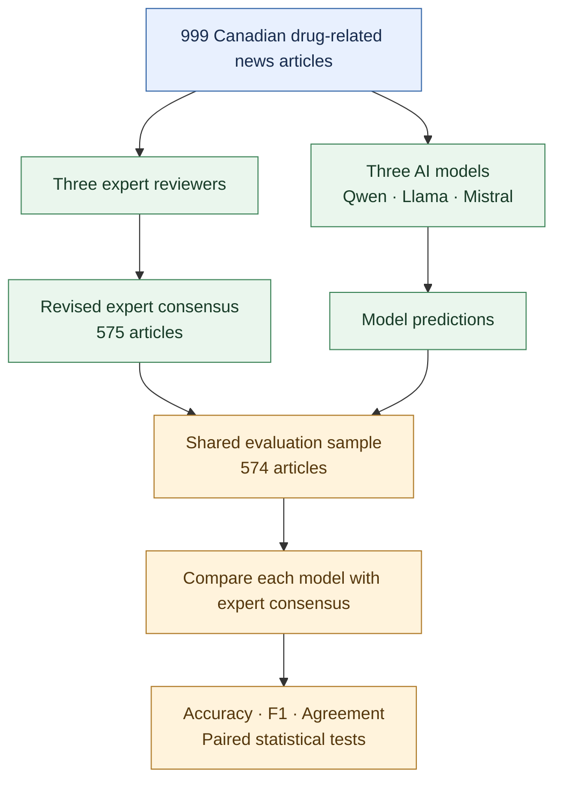
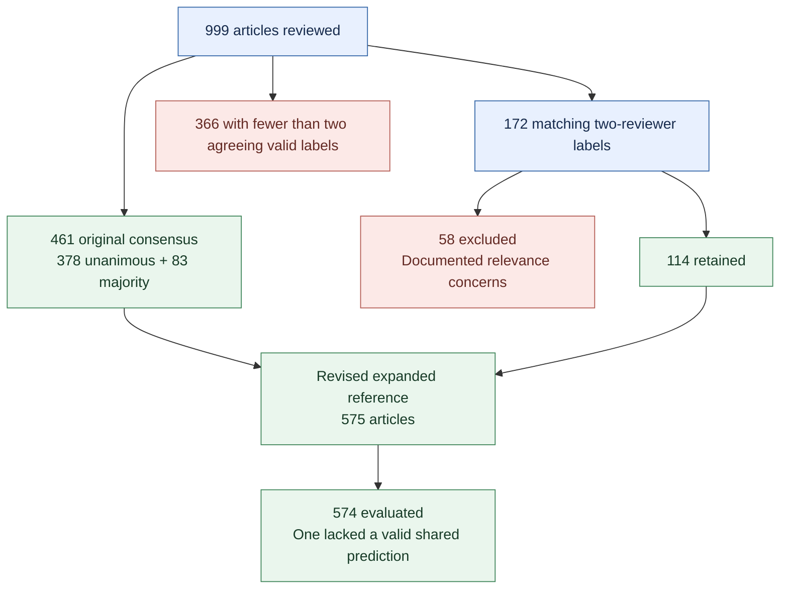

# CCSA drug-related news classification: reproducibility guide

## Project overview

This project compares three locally run small language models—Qwen, Llama, and Mistral—against expert annotations of **999 Canadian drug-related news articles**. Each article is assigned one of three categories: **Drug Alert**, **Public Safety**, or **Public Health**. The evaluation compares models on identical article IDs and reports both the original complete-reviewer reference and an expanded available-reviewer consensus.

This README describes the current revised analysis and identifies settings that cannot be established from the supplied scripts. It does not claim that every expert-reviewed article was eligible or adjudicated.

### Study at a glance

The same 999 articles were reviewed by human experts and classified independently by three AI models. The final comparison uses only articles with an eligible expert consensus **and** valid predictions from all three models.



**At a glance:** 999 articles → 575 eligible expert consensus labels → **574 shared model comparisons**.

## Data and directory layout

Working research repository layout (selected files; **not a proposed public file manifest**):

```text
CCSA Project/
├── data/
│   ├── ArticlesV2_Blind_review.csv
│   ├── ArticlesV2_Blind_review_qwen.csv
│   ├── ArticlesV2_Blind_review_llama.csv
│   ├── ArticlesV2_Blind_review_mistral.csv
│   └── Reviewer 1, 2, and 3 annotation workbooks (.xlsx)
├── docs/
├── scripts/
│   ├── audit_missingness.py
│   ├── expert_consensus.py
│   ├── reproduce_model_comparison.py
│   ├── reproduce_qwen.py
│   ├── reproduce_llama.py
│   ├── reproduce_mistral.py
│   ├── run_qwen.py
│   ├── run_llama.py
│   ├── run_mistral.py
│   └── test_reliability.py
├── results/
│   ├── consensus_results/
│   ├── model_comparison_results/       # original comparison
│   ├── model_comparison_expanded/      # revised expanded comparison
│   ├── qwen_results/
│   ├── llama_results/
│   └── mistral_results/
├── .gitignore
└── README.md
```

The `run_*.py` scripts are the preserved Ollama inference workflows with project-root-relative paths. The `reproduce_*.py` scripts are also present, but are distinct from the inference scripts and the main `reproduce_model_comparison.py` evaluation workflow. Model-specific result directories retain the individual model outputs. The `docs/` directory is retained for project documentation.

Key columns: `review_id` identifies the article across files; `article_text` supplies model input; `reviewed_primary_category` contains expert or model category labels; reviewer workbooks may contain `review_notes`. The consensus script normalizes the observed variants `Public healh` → `Public Health` and `Drug alert` → `Drug Alert`. Blank and `N/A` expert values are **not** valid category labels.

## Expert annotation and consensus

### How the expert reference was built



The 58 excluded two-reviewer agreements remain in the audit files; they are **not** part of the final 575-article reference. The other 366 articles comprise 21 conflicting two-reviewer labels, 43 single-reviewer labels, and 302 articles without a valid label.


All three reviewer files cover the same 999 IDs, but not every reviewer supplied a category for every article. A blank cell does not have a single universal interpretation: possible reasons include an incomplete review, a language-related omission, a relevance concern, or an unexplained omission. Explicit `N/A` is also treated as non-category information rather than as a fourth class.

| Reference group | Definition | Number of articles |
|---|---|---:|
| Unanimous (3/3) | All three supplied the same valid label | 378 |
| Majority (2/3) | All three supplied valid labels; two agreed | 83 |
| **Original consensus** | 3/3 plus 2/3 | **461** |
| Available-reviewer agreement (2/2), identified | Exactly two valid labels, both identical | 172 |
| Excluded from expanded reference | Two-reviewer agreements with documented relevance concerns | 58 |
| Available-reviewer agreement (2/2), retained | Identified 2/2 agreements minus 58 flagged cases | 114 |
| **Revised expanded consensus** | Original plus 114 retained 2/2 agreements | **575** |

Of the 999 articles, 461 had three valid reviewer labels, 193 had exactly two (172 agreeing and 21 conflicting), 43 had one, and 302 had none. The 424 articles outside the expanded 575 comprise 58 flagged but agreeing two-reviewer cases, 21 conflicting two-reviewer cases, 43 single-label cases, and 302 unlabeled cases.

The 172 agreeing two-reviewer cases were examined individually to characterize the missing third label:

| Audit group | Reviewer-specific observation | Articles | Expanded reference |
|---|---|---:|---|
| Documented relevance concerns | Reviewers **1 and 3** agreed; Reviewer **2** did not supply a category and instead recorded a relevance concern in review notes | **58** | Excluded |
| French-language articles | Reviewers **2 and 3**, both of whom understood French, agreed; Reviewer **1** did not annotate these articles because they did not understand French | **54** | Retained |
| Outside observed Reviewer 2 annotation coverage | Reviewers **1 and 3** agreed; Reviewer **2** supplied no category, and these article IDs were above **599**, the last ID annotated by Reviewer 2 | **57** | Retained |
| Unexplained missing labels | Reviewers **2 and 3** agreed; Reviewer **1** supplied no category or documented explanation (IDs **99, 231, 484**) | **3** | Retained |
| **Total** | | **172** | **114 retained** |

The 58 exclusions reflect **Reviewer 2's recorded concerns**, not independently verified out-of-domain determinations or formal three-reviewer adjudication. For the 57 coverage cases, article ID range describes the observed pattern but does not establish why Reviewer 2 did not annotate them. The three unexplained cases remain unresolved. The 54 French-language articles were classified by all three models **in their original French text without translation**; the audit does not establish French-subset model performance beyond the available reviewer-label comparisons. Language itself was not an exclusion criterion. The 114 retained articles were added on the basis of two agreeing valid reviewer labels, subject to the stated exclusion of the 58 relevance-flagged cases.

**Interpretation:** The expanded reference is an *available-reviewer consensus*, not a fully adjudicated gold standard. Two agreeing reviewers do not resolve a third reviewer's concerns about relevance. The 21 conflicting 2/2 cases remain excluded from accuracy calculations; this is a possible source of selection bias.

The updated `expert_consensus.py` saves original reviewer coverage, label availability, consensus summary, reliability and article audit outputs in `results/consensus_results/`, and adds:

- `expanded_consensus_reference.csv` — 575 retained consensus classifications with agreement basis and relevance flag.
- `expanded_article_level_audit.csv` — all 999 articles, reviewer labels and expanded-consensus status.
- `two_reviewer_agreement_cases.csv` — the 172 additional agreement cases.
- `expanded_consensus_summary.csv` — revised reference-group and class counts.
- `two_reviewer_missingness_audit.csv` and `two_reviewer_missingness_summary.csv` — outputs from `scripts/audit_missingness.py`, preserving all 172 identified 2/2 agreements and their missingness classifications.

The missingness audit script uses reviewer notes, observed reviewer-ID coverage, and automated language detection on the first 3,000 characters of article text (`langdetect` French probability threshold: 0.90). **These script-based flags should not be mistaken for the full reviewer-specific explanation above:** the French non-annotation reason was subsequently clarified, while the 57 coverage-related and three unexplained omissions have not been independently resolved. The script should be checked against the reviewer-specific audit before its categories are presented as verified causes.

## Models and inference

The three supplied inference scripts use the **Ollama** Python client (`ollama.chat`) and the same prompt template and label-extraction logic:

| Model | Ollama tag in script | Input text | Save interval |
|---|---|---|---|
| Qwen | `qwen2.5:7b` | First 1,200 characters | Every 25 processed rows |
| Llama | `llama3.1:8b` | First 1,200 characters | Every 25 processed rows |
| Mistral | `mistral:7b` | First 1,200 characters | Every 25 processed rows |

The first **1,200 characters** were used to limit computational time for locally run inference across 999 articles. This was a pragmatic constraint, **not** an empirically optimized input length. The median source article length was **2,812 characters**, and **844/999 (84.5%)** articles exceeded 1,200 characters; consequently, potentially relevant information later in articles may have been omitted. Input-length sensitivity was not tested.

Each article is submitted in a **user-role message**. The prompt defines the three categories with examples, directs the model to output exactly one label, gives **Drug Alert** priority, directs policing/crime-focused articles to **Public Safety**, and otherwise defaults to **Public Health**. Secondary topics are ignored. The full prompt is preserved in the inference scripts and should be retained verbatim for reproducibility.

**Response parsing:** Each script lowercases the model's returned text and checks for the substrings `drug alert`, then `public safety`, then `public health`, in that priority order. If none appears, it records `Unknown`. This is a heuristic parser: it does **not** validate that the response is exactly one category, and can be influenced by extra text. A successful Ollama call that produces `Unknown` is not retried; exceptions are retried after a five-second wait. The scripts resume from saved output files and skip rows with nonempty classifications. They do not explicitly filter by article language.

**Environment information not recorded in the scripts:** Ollama application version, precise downloaded model digest/build, effective default sampling parameters (including temperature), hardware, and random seed. No inference `options` or explicit random seed are passed to `ollama.chat`. Record these separately for a fully specified reproduction; do not assume the current Ollama defaults match the original environment. Inference outputs should be treated as archived experimental predictions rather than regenerated silently.

### Reproducing model inference (optional)

**Warning:** Rerunning inference may yield different responses and could overwrite or alter archived prediction CSVs. Back up the original files first. From the project root:

```bash
python3 scripts/run_qwen.py
python3 scripts/run_llama.py
python3 scripts/run_mistral.py
```

The Ollama service must be running and the specified model tags available locally. Model downloads, versions and checksums should be recorded before rerunning.

## Evaluation design

The updated model-comparison script reads `results/consensus_results/expanded_consensus_reference.csv` rather than independently rebuilding consensus. It compares Qwen, Llama and Mistral on the **same article IDs within each subset**. An article is excluded from the shared evaluation if any model prediction is missing, `Unknown`, `N/A`, or otherwise not one of the three categories; it remains in the expert-consensus reference.

| Evaluation subset | Reference N | Shared evaluable N |
|---|---:|---:|
| Original consensus | 461 | 460 |
| Revised expanded consensus | 575 | 574 |
| Unanimous (3/3) | 378 | 377 |
| Majority (2/3) | 83 | 83 |
| Two available reviewers agree (2/2), retained | 114 | 114 |

One original-consensus article (ID **587**) has an invalid **Llama** classification (`Unknown`) and is not evaluable across all three models, leaving 460 original and 574 revised expanded articles in the shared evaluation. The 58 excluded relevance-flagged 2/2 cases are not part of the revised reference. The shared-sample rule ensures like-for-like comparisons, but may itself exclude challenging cases.

The script reports accuracy, macro precision/recall/F1, weighted F1, Cohen's kappa, and Matthews correlation coefficient. It also reports category-specific precision, recall, F1 and support, including the minority Drug Alert class. Accuracy uncertainty is estimated with **95% Wilson score confidence intervals**. Pairwise accuracy is assessed using **exact two-sided McNemar tests** on the same articles. The script exports both **unadjusted and Holm-adjusted p-values**, correcting the three model-pair comparisons separately within each reference subset. No model-pair difference was significant at 0.05 after Holm correction in the revised expanded subset. Interpret the primary reference set as predeclared where applicable; analyses of overlapping subsets should be described as exploratory, not as independent replications.

Earlier exploratory analyses using a broader two-reviewer reference should not be presented as the final evaluation. The final expanded reference excludes the 58 reviewer-flagged cases; this exclusion does not independently establish that those articles were irrelevant. Archive historical sensitivity outputs separately from the current results.

### Model accuracy at a glance

| Model | Original consensus (N=460) | Revised expanded consensus (N=574) |
|---|---:|---:|
| Qwen | 91.1% | 90.9% |
| Llama | 89.3% | 89.5% |
| Mistral | 89.1% | 88.3% |

**Quick interpretation:** Qwen had the highest observed accuracy in both samples. However, none of the three model-pair differences in the revised expanded sample was statistically significant after Holm adjustment. These estimates are descriptive; lack of statistical significance does not establish equivalence.

## Dependencies and execution

Python 3 with these packages is required for the documented scripts:

```bash
python3 -m pip install pandas numpy openpyxl scikit-learn scipy ollama statsmodels langdetect
```

`pandas` and `ollama` are used for inference; `numpy`, `openpyxl` and `scikit-learn` support the consensus and comparison workflows; `scipy` for the exact McNemar p-values; `statsmodels` for Holm correction and independent Fleiss' kappa validation in the unit tests; and `langdetect` for the missingness audit. Standard-library dependencies do not require installation. The package versions used originally were not recorded in the supplied scripts; for a future rerun, capture a lockfile or `pip freeze` and the Python version.

From the project root, run the updated scripts in this order:

```bash
python3 scripts/expert_consensus.py
python3 scripts/audit_missingness.py
python3 scripts/reproduce_model_comparison.py
```

Expected outputs:

```text
results/consensus_results/
    reviewer_coverage.csv
    label_availability.csv
    consensus_summary.csv
    reviewer_reliability.csv
    article_level_audit.csv
    expanded_article_level_audit.csv
    expanded_consensus_reference.csv
    two_reviewer_agreement_cases.csv
    expanded_consensus_summary.csv
    two_reviewer_missingness_audit.csv
    two_reviewer_missingness_summary.csv

results/model_comparison_expanded/
    model_comparison.csv
    model_confidence_intervals.csv
    paired_model_tests.csv
    class_specific_performance.csv
    comparison_coverage.csv
    comparison_article_level_audit.csv
```

The original `results/model_comparison_results/` directory is retained separately and is not overwritten by this workflow. The current script writes into `results/model_comparison_expanded/` and **overwrites files with matching names in that directory**. Any previous `relevance_sensitivity.csv` should be moved out of this active folder, as the revised script does not regenerate it. `paired_model_tests.csv` contains the paired comparisons and multiplicity-adjusted p-values. Confirm the actual script outputs before listing any additional compatibility exports.

## Reliability analysis and outstanding validation

The consensus script calculates pairwise Cohen's kappa on articles with valid labels from the relevant reviewer pair; Fleiss' kappa and Gwet's AC1 on complete three-reviewer cases; and nominal Krippendorff's alpha on articles with at least two valid labels. These statistics use different eligible samples and must not be interpreted as interchangeable.

### Reliability calculation validation

The hand-implemented inter-rater reliability functions were checked using **nine automated unit tests** in `scripts/test_reliability.py`. All nine tests passed in the reported local run.

- **Fleiss’ κ:** compared with `statsmodels.stats.inter_rater.fleiss_kappa` on a controlled dataset; perfect agreement tested.
- **Gwet’s AC1:** compared with a separately coded nominal AC1 reference calculation; perfect agreement tested.
- **Krippendorff’s α:** compared with a separately coded nominal alpha reference calculation; missing reviewer annotations and perfect agreement tested.
- **Edge cases:** empty inputs and single-category annotations tested.

Run the tests from the project root:

```bash
python3 scripts/test_reliability.py
```

These tests support correctness for the tested cases; they do **not** independently reproduce the reported reliability coefficients using the complete reviewer dataset. The Gwet’s AC1 and Krippendorff’s α comparisons use independently coded formulas, not external package implementations. Additional edge-case and full-dataset verification remain possible future checks.

**Still to complete:** capture software/package versions, record Ollama model digests and execution environment, and optionally refactor shared data-loading and evaluation functions.

## Reporting considerations and limitations

- Distinguish **999 source articles**, **575 revised consensus-labeled articles**, and **574 shared evaluable predictions**.
- Explicitly separate 3/3, 2/3 and 2/2 agreement. A 2/2 agreement is not a third-reviewer endorsement.
- Report the 58 documented relevance concerns, their exclusion from the revised reference, and the retained 172-case missingness audit. The reason for three other blanks remains unexplained, and the reviewer-specific reasons and remaining uncertainties described above.
- Note that the 21 two-reviewer disagreements lack consensus and are excluded; a change in accuracy after adding only agreeing cases does not eliminate selection-bias concerns.
- Discuss low Drug Alert support and false-positive Drug Alert predictions; class-wise precision and recall are more informative than accuracy alone.
- Avoid treating statistical significance on overlapping subsets as independent confirmation. Record the multiplicity correction used in the manuscript.
- The 1,200-character truncation may remove relevant evidence; no input-length sensitivity experiment was conducted.
- Do not publish raw copyrighted article text, personal information, or restricted reviewer notes in a public repository without appropriate permission. Provide access-controlled data and document how authorized researchers can obtain the inputs.

## Code and data availability

The intended public release covers **analysis code, classification prompts, documentation, and non-restricted aggregate results**, subject to a final repository audit. Article text, reviewer workbooks, reviewer notes, and article-level model predictions or audit outputs must **not** be presumed redistributable: the underlying material was provided by CCSA and may also be subject to platform and copyright restrictions. Confirm CCSA authorization and applicable terms before releasing any such files.

**Publication safety check:** The current working repository has previously tracked reviewer workbooks and model prediction CSVs. Removing files from the latest commit is insufficient if their contents remain accessible in Git history. Audit and, where necessary, rewrite the entire history or create a new clean public repository containing only approved materials **before** changing visibility. This README is not evidence that the repository has been sanitized.

Authorized researchers would need access to the original input data and annotations to reproduce the numerical results; publicly available code alone does not provide a complete end-to-end reproduction. Model reruns may also differ because the original Ollama versions, model digests, and sampling defaults were not fully recorded.
