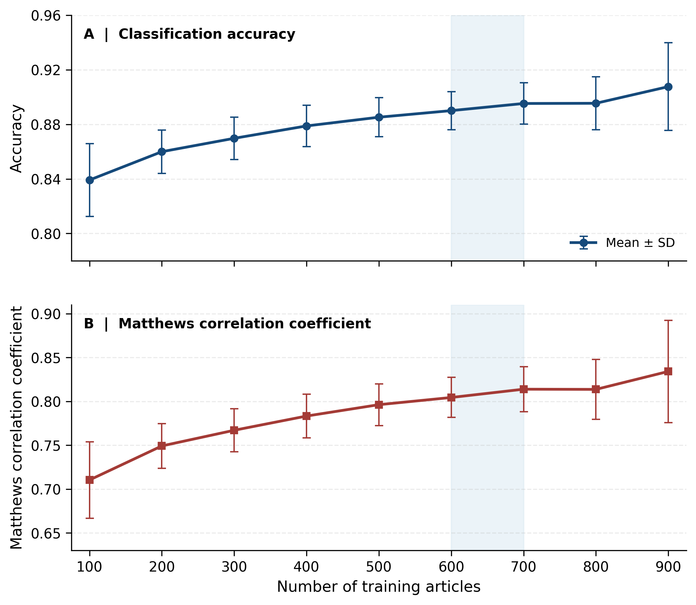

# CCSA drug-related news classification: reproducibility guide

## Project overview

This project compares three locally run small language models—Qwen, Llama, and Mistral—against expert annotations of **999 Canadian drug-related news articles**. Each article is assigned one of three categories: **Drug Alert**, **Public Safety**, or **Public Health**. The evaluation compares models on identical article IDs and reports both the original complete-reviewer reference and an expanded available-reviewer consensus.

This README describes the analysis as implemented and identifies settings that cannot be established from the supplied scripts. It does not claim that every expert-reviewed article was eligible or adjudicated.

## Data and directory layout

Expected project layout (place the scripts in `scripts/` and input files in `data/`):

```text
project/
├── data/
│   ├── ArticlesV2_Blind_review.csv
│   ├── Reviewer 1 - Articles and Labels for review.xlsx
│   ├── Reviewer 2 - Articles and Labels for review.xlsx
│   ├── Reviewer 3 - Articles and Labels for review.xlsx
│   ├── ArticlesV2_Blind_review_qwen.csv
│   ├── ArticlesV2_Blind_review_llama.csv
│   └── ArticlesV2_Blind_review_mistral.csv
├── scripts/
│   ├── expert_consensus.py
│   ├── learning_curve_logreg.py
│   ├── reproduce_model_comparison.py
│   ├── test_reliability.py
│   ├── qwen_1000_articles.py
│   ├── llama_1000_articles.py
│   └── mistral_1000_articles.py
└── results/
    └── learning_curve/
        ├── learning_curve_repeated_results.csv
        └── learning_curve.png
```

The inference scripts as supplied use **relative filenames**, not the `data/` directory. To rerun inference, run them from the directory containing `ArticlesV2_Blind_review.csv`, or adjust their `INPUT_FILE` and `OUTPUT_FILE` paths. The evaluation scripts assume the directory structure shown above. Verify paths and filenames before execution.

Key columns: `review_id` identifies the article across files; `article_text` supplies model input; `reviewed_primary_category` contains expert or model category labels; reviewer workbooks may contain `review_notes`. The consensus script normalizes the observed variants `Public healh` → `Public Health` and `Drug alert` → `Drug Alert`. Blank and `N/A` expert values are **not** valid category labels.

## Preliminary learning-curve analysis and annotation planning

Before expert review, an exploratory learning-curve experiment was conducted to help set a **pragmatic annotation target of approximately 600 articles per reviewer**. This was a planning exercise, not a validation of the eventual expert-consensus sample size.

The experiment used `scripts/learning_curve_logreg.py` to fit a **TF-IDF + logistic regression** classifier to articles with **Qwen-generated category labels** as the target. It did **not** use expert-validated labels. The TF-IDF vectorizer used up to 10,000 features, unigram/bigram features (`ngram_range=(1, 2)`), and English stop-word removal. Logistic regression used `class_weight="balanced"` and `max_iter=1000`. For each training size from 100 to 900 in increments of 100, the code performed **20 stratified random train/test splits** (seeds 0–19), refitting the entire pipeline each time. The test set was the remainder of the available articles, so **test-set size decreased as training size increased**. The script reports mean and sample standard deviation (SD) for accuracy, macro F1, weighted F1, and Matthews correlation coefficient (MCC).

| Training articles | Test articles | Accuracy (mean) | Macro F1 (mean) | MCC (mean) |
|---|---:|---:|---:|---:|
| 500 | 498 | 0.885 | 0.844 | 0.796 |
| 600 | 398 | 0.890 | 0.854 | 0.804 |
| 700 | 298 | 0.895 | 0.862 | 0.814 |
| 800 | 198 | 0.895 | 0.860 | 0.814 |
| 900 | 98 | 0.908 | 0.877 | 0.834 |

The relatively small gains between **600 and 800 training articles** informed the initial annotation workload target. Performance increased again at 900, however, and the smallest test sets had greater variability. **The experiment does not establish 600 as a statistically optimal sample size**, demonstrate sufficient expert agreement, or show that the eventual evaluation is free from missing-annotation bias. Those issues are addressed separately through the consensus audit and sensitivity analyses.

To reproduce the exploratory experiment, place the Qwen prediction CSV where the script expects it (or update its input path), then run from the appropriate working directory:

```bash
python scripts/learning_curve_logreg.py
```

The current plotting addition saves `results/learning_curve/learning_curve.png`, while the existing output section saves `results/learning_curve/learning_curve_repeated_results.csv`. The PNG displays accuracy and MCC in separate panels, with SD error bars and a shaded 600–700-article planning range. **The CSV contains the full set of four metrics**; the figure is a selective visualization. If your local script still reads `ArticlesV2_Blind_review_qwen.csv` using a relative filename, run it from the directory containing that file or change the path to `data/ArticlesV2_Blind_review_qwen.csv` using the project root. Re-running the script performs all 180 fits again.



## Expert annotation and consensus

All three reviewer files cover the same 999 IDs, but not every reviewer supplied a category for every article. A blank cell does not have a single universal interpretation: possible reasons include an incomplete review, a language-related omission, a relevance concern, or an unexplained omission. Explicit `N/A` is also treated as non-category information rather than as a fourth class.

| Reference group | Definition | Number of articles |
|---|---|---:|
| Unanimous (3/3) | All three supplied the same valid label | 378 |
| Majority (2/3) | All three supplied valid labels; two agreed | 83 |
| **Original consensus** | 3/3 plus 2/3 | **461** |
| Available-reviewer agreement (2/2) | Exactly two valid labels, both identical | 172 |
| **Expanded consensus** | Original plus 2/2 | **633** |

The remaining articles are not automatically assigned a consensus: 21 have two valid but conflicting labels, 43 have only one valid label, and 302 have none. These groups sum with the 633 consensus cases to 999.

The 172 additional 2/2 cases were audited for missingness: **58** have documented relevance concerns from the missing reviewer; **54** were flagged as likely French-language omissions using automated language identification (not independently confirmed); **57** are beyond a reviewer's observed annotation range (an inference from coverage); and **3** have unexplained blank annotations. These are descriptive missingness categories, not validated eligibility determinations. The 58 relevance-flagged cases are **included** in the expanded reference and flagged for sensitivity analysis. Language is not used as an automatic exclusion rule.

**Interpretation:** The expanded reference is an *available-reviewer consensus*, not a fully adjudicated gold standard. Two agreeing reviewers do not resolve a third reviewer's concerns about relevance. The 21 conflicting 2/2 cases remain excluded from accuracy calculations; this is a possible source of selection bias.

The updated `expert_consensus.py` saves its original reviewer coverage, label availability, consensus summary, reliability and article audit outputs in `results/consensus_results/`, and adds:

- `expanded_consensus_reference.csv` — 633 consensus classifications with agreement basis and relevance flag.
- `expanded_article_level_audit.csv` — all 999 articles, reviewer labels and expanded-consensus status.
- `two_reviewer_agreement_cases.csv` — the 172 additional agreement cases.
- `expanded_consensus_summary.csv` — reference-group and class counts.

## Models and inference

The three supplied inference scripts use the **Ollama** Python client (`ollama.chat`) and the same prompt template and label-extraction logic:

| Model | Ollama tag in script | Input text | Save interval |
|---|---|---|---|
| Qwen | `qwen2.5:7b` | First 1,200 characters | Every 25 processed rows |
| Llama | `llama3.1:8b` | First 1,200 characters | Every 25 processed rows |
| Mistral | `mistral:7b` | First 1,200 characters | Every 25 processed rows |

Each article is submitted in a **user-role message**. The prompt defines the three categories with examples, directs the model to output exactly one label, gives **Drug Alert** priority, directs policing/crime-focused articles to **Public Safety**, and otherwise defaults to **Public Health**. Secondary topics are ignored. The full prompt is preserved in the inference scripts and should be retained verbatim for reproducibility.

**Response parsing:** Each script lowercases the model's returned text and checks for the substrings `drug alert`, then `public safety`, then `public health`, in that priority order. If none appears, it records `Unknown`. This is a heuristic parser: it does **not** validate that the response is exactly one category, and can be influenced by extra text. A successful Ollama call that produces `Unknown` is not retried; exceptions are retried after a five-second wait. The scripts resume from saved output files and skip rows with nonempty classifications. They do not explicitly filter by article language.

**Environment information not recorded in the scripts:** Ollama application version, precise downloaded model digest/build, effective default sampling parameters (including temperature), hardware, and random seed. No inference `options` or explicit random seed are passed to `ollama.chat`. Record these separately for a fully specified reproduction; do not assume the current Ollama defaults match the original environment. Inference outputs should be treated as archived experimental predictions rather than regenerated silently.

### Reproducing model inference (optional)

**Warning:** Rerunning inference may yield different responses and could alter an existing output file. Back up the original prediction CSVs first. Run from the input-data directory or change the paths in each inference script:

```bash
python ../scripts/qwen_1000_articles.py
python ../scripts/llama_1000_articles.py
python ../scripts/mistral_1000_articles.py
```

The Ollama service must be running and the specified model tags available locally. Model downloads, versions and checksums should be recorded before rerunning.

## Evaluation design

The updated model-comparison script reads `results/consensus_results/expanded_consensus_reference.csv` rather than independently rebuilding consensus. It compares Qwen, Llama and Mistral on the **same article IDs within each subset**. An article is excluded from the shared evaluation if any model prediction is missing, `Unknown`, `N/A`, or otherwise not one of the three categories; it remains in the expert-consensus reference.

| Evaluation subset | Reference N | Shared evaluable N |
|---|---:|---:|
| Original consensus | 461 | 460 |
| Expanded consensus | 633 | 628 |
| Unanimous (3/3) | 378 | 377 |
| Majority (2/3) | 83 | 83 |
| Two available reviewers agree (2/2) | 172 | 168 |
| Expanded excluding relevance concerns | 575 | 574 |

Of the five expanded-reference cases not evaluated, four are 2/2 relevance-flagged articles with an `Unknown` Llama prediction (IDs **150, 224, 523, 589**). These are not the same as the previously investigated expert annotation blanks (IDs 99, 231, 340, 484). The shared-sample rule ensures like-for-like comparisons, but may itself exclude challenging cases.

The script reports accuracy, macro precision/recall/F1, weighted F1, Cohen's kappa, and Matthews correlation coefficient. It also reports category-specific precision, recall, F1 and support, including the minority Drug Alert class. Accuracy uncertainty is estimated with **95% Wilson score confidence intervals**. Pairwise accuracy is assessed using **exact two-sided McNemar tests** on the same articles. The output script produces **unadjusted p-values**. Holm-adjusted p-values were calculated separately for the three pairwise model comparisons, but are not yet exported in the reproducibility script. Apply the adjustment within a predeclared primary reference set before interpreting statistical significance. Analyses of overlapping subsets should be described as exploratory, not as independent replications.

A relevance sensitivity analysis compares the expanded shared sample against the same approach with relevance-flagged articles excluded; this removes 54 *evaluable* articles (four flagged articles already lack a valid shared prediction). It does not establish that the flagged articles are irrelevant.

### Observed accuracy from saved predictions

| Model | Original consensus (N=460) | Expanded consensus (N=628) |
|---|---:|---:|
| Qwen | 91.1% | 91.2% |
| Llama | 89.3% | 89.5% |
| Mistral | 89.1% | 88.5% |

These estimates are descriptive; differences should not be interpreted as evidence of model superiority without paired testing and consideration of uncertainty, multiplicity and reference-label limitations.

## Dependencies and execution

Python 3 with these packages is required for the documented scripts:

```bash
python -m pip install pandas numpy matplotlib openpyxl scikit-learn scipy ollama statsmodels
```

`pandas` and `ollama` are used for inference; `numpy` and `matplotlib` are used for the learning-curve experiment and figure; `openpyxl` and `scikit-learn` for the consensus and comparison workflows; `scipy` for the exact McNemar p-values; and `statsmodels` for independent Fleiss' kappa validation in the unit tests. Standard-library dependencies do not require installation. The package versions used originally were not recorded in the supplied scripts; for a future rerun, capture a lockfile or `pip freeze` and the Python version.

From the project root, run the updated scripts in this order:

```bash
python scripts/expert_consensus.py
python scripts/reproduce_model_comparison.py
```

Expected outputs:

```text
results/consensus_results/
    reviewer_coverage.csv
    label_availability.csv
    consensus_summary.csv
    reviewer_reliability.csv
    article_level_audit.csv
    expanded_article_level_audit.csv
    expanded_consensus_reference.csv
    two_reviewer_agreement_cases.csv
    expanded_consensus_summary.csv

results/model_comparison_expanded/
    model_comparison.csv
    model_confidence_intervals.csv
    paired_model_tests.csv
    pairwise_correctness.csv
    class_specific_performance.csv
    comparison_coverage.csv
    relevance_sensitivity.csv
    comparison_article_level_audit.csv
```

The original `results/model_comparison_results/` directory is intentionally not overwritten. Note that `paired_model_tests.csv` and `pairwise_correctness.csv` are duplicate exports in the supplied updated comparison script, retained for compatibility; neither is a Holm-adjusted p-value table.

## Reliability analysis and outstanding validation

The consensus script calculates pairwise Cohen's kappa on articles with valid labels from the relevant reviewer pair; Fleiss' kappa and Gwet's AC1 on complete three-reviewer cases; and nominal Krippendorff's alpha on articles with at least two valid labels. These statistics use different eligible samples and must not be interpreted as interchangeable.

### Reliability calculation validation

The hand-implemented inter-rater reliability functions were checked using **nine automated unit tests** in `scripts/test_reliability.py`. All nine tests passed in the reported local run.

- **Fleiss’ κ:** compared with `statsmodels.stats.inter_rater.fleiss_kappa` on a controlled dataset; perfect agreement tested.
- **Gwet’s AC1:** compared with a separately coded nominal AC1 reference calculation; perfect agreement tested.
- **Krippendorff’s α:** compared with a separately coded nominal alpha reference calculation; missing reviewer annotations and perfect agreement tested.
- **Edge cases:** empty inputs and single-category annotations tested.

Run the tests from the project root:

```bash
python scripts/test_reliability.py
```

These tests support correctness for the tested cases; they do **not** independently reproduce the reported reliability coefficients using the complete reviewer dataset. The Gwet’s AC1 and Krippendorff’s α comparisons use independently coded formulas, not external package implementations. Additional edge-case and full-dataset verification remain possible future checks.

**Still to complete:** capture software/package versions, record Ollama model digests and execution environment, and optionally refactor shared data-loading and evaluation functions.

## Reporting considerations and limitations

- Distinguish **999 source articles**, **633 consensus-labeled articles**, and **628 shared evaluable predictions**.
- Explicitly separate 3/3, 2/3 and 2/2 agreement. A 2/2 agreement is not a third-reviewer endorsement.
- Report the 58 documented relevance concerns and the sensitivity analysis. The reason for three other blanks remains unexplained, and automated French-language detection is provisional.
- Note that the 21 two-reviewer disagreements lack consensus and are excluded; a change in accuracy after adding only agreeing cases does not eliminate selection-bias concerns.
- Discuss low Drug Alert support and false-positive Drug Alert predictions; class-wise precision and recall are more informative than accuracy alone.
- Avoid treating statistical significance on overlapping subsets as independent confirmation. Record the multiplicity correction used in the manuscript.
- Do not publish raw copyrighted article text, personal information, or restricted reviewer notes in a public repository without appropriate permission. Provide de-identified or access-controlled data and document how authorized researchers can obtain the inputs.

## Reproducibility checklist

- [x] Preliminary Qwen-label learning curve, annotation-planning rationale, and limitations documented.
- [x] Model tags, prompt and response parser documented from inference scripts.
- [x] Original and expanded consensus rules documented.
- [x] Shared-sample evaluation and invalid-prediction exclusions documented.
- [x] Accuracy intervals, exact paired tests, class-specific results and relevance sensitivity described.
- [ ] Archive exact Ollama model digests, Ollama version and execution environment.
- [ ] Pin Python and dependency versions.
- [x] Run nine automated unit tests of the hand-implemented reliability calculations (all passed on controlled cases).
- [ ] Add Holm-adjusted p-values to a saved results file (currently calculated separately).
- [ ] Review and approve data-sharing restrictions and final manuscript language.
